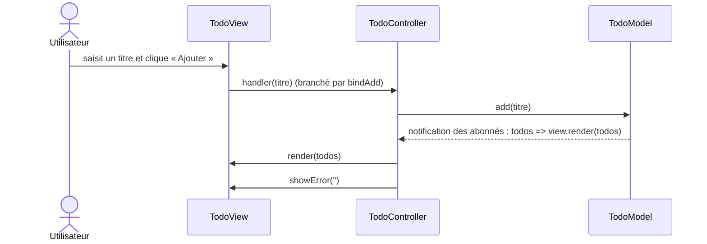
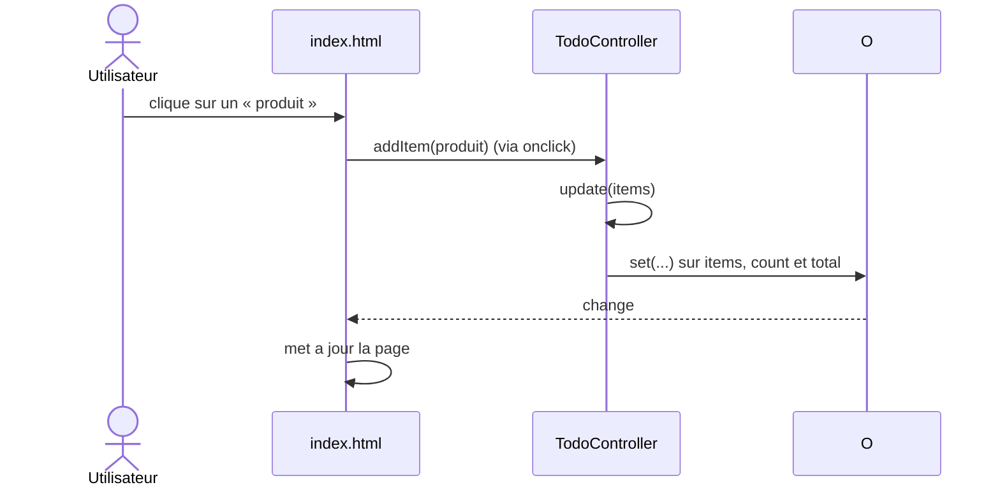

# TP 1 parcours Data / Cyber

## Étape 1 · Faire tourner et observer

| Question | MVC (Todo) | MVP (Connexion) | MVVM (Panier) |
|---|---|---|---|
| Quel fichier reçoit le clic de l'utilisateur ? | TodoController.js | index.html | index.html |
| Quel fichier contient la règle de validation ? |TodoModel.js | LoginPresenter.js | CartViewModel.js mais different des autres avant plus des verification pas validation |
| Qui met l'écran à jour, et comment ? |TodoView.js, on recevant les informations venant du controleur et  s'adapte selon l'action de l'utilsateur | LoginPresenter.js, selon la situation de l'utilisateur elle excute des actions differente | index on déclenchant observable |
| Combien de tests ? Ont-ils besoin du navigateur ?  | 3 test , non peuvent etre fais par cli |  3 et non| 2 test |

## Etapes 2

# Etape 3

La verification est bonne,  le test fonctionne mais le test sous navigateur de fonctionne pas .